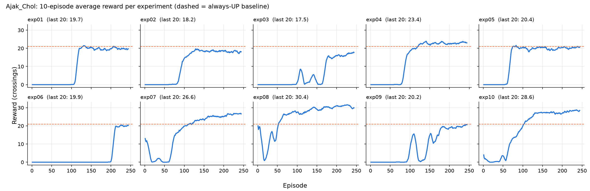

# Hyperparameter Experiment Results

**Member Name:** Ajak Chol

**Focus:** ε start, ε end and ε decay (the exploration schedule). Batch size is 64 in most runs as the
second changed value, because Keane's runs 1-5 showed batch size had no clear effect on the score.

**Fixed settings for all runs:** 500,000 total steps (244 episodes of 2,048 steps), replay buffer 50,000,
learning starts after 10,000 steps, train every 4 steps, target network update every 1,000 steps, seed 42.
Runs were done on Kaggle (2 × Tesla T4), three at a time, about 30 minutes each.
The notebook used is [notebooks/ajak_kaggle_experiments.ipynb](notebooks/ajak_kaggle_experiments.ipynb).

**Baselines:** random agent = 0, always UP = 21. Control = the group baseline (Eddy exp01: lr 1e-4,
γ 0.99, batch 32, ε 1.0 → 0.05 over 250k), greedy score 21.0.

**Starting question:** greedy evaluation of Eddy's and Keane's 20 models showed that 17 only learned
"always press UP" (21). I expected that exploring more late in training (a higher ε end) would stop this.
The results showed the opposite: ε end did not help, and **ε start** made the difference.

## Experiment table

| Experiment | Learning rate | Gamma | Batch size | Epsilon start | Epsilon end | Epsilon decay (steps) | Observed behaviour |
|---|---|---|---|---|---|---|---|
| 1 | 1e-4 | 0.99 | 64 | 1.0 | 0.10 | 250,000 | Reward stayed at 0 until episode 99 (ε ≈ 0.28), then jumped to about 20 within 15 episodes and stayed there (last-20 mean 19.7). Greedy play presses UP on 100% of steps (21), so a higher ε end than the control (0.10 vs 0.05) did not change what the agent learned. |
| 2 | 1e-4 | 0.99 | 64 | 1.0 | 0.20 | 250,000 | First reward at episode 61 (an early lucky crossing while ε was still 0.6), steady rewards from about episode 85, and training levelled off at 18.2, lower than run 1, because 20% of actions stayed random. Greedy: always UP (21). Raising ε end to 0.20 only lowered the training score. |
| 3 | 1e-4 | 0.99 | 64 | 1.0 | 0.30 | 250,000 | **Worst run.** Learning was unstable: the average rose to about 8 at episode 105, collapsed to 0, rose again and collapsed again, and only reached a steady level after episode 170 (last-20 mean 17.5, best episode 20). Greedy score 18.7, below the always-UP baseline; the agent mixes UP (62%) with NOOP (27%) and DOWN (12%) without having learned when to use them. 30% random actions make the replay data too noisy to learn a stable policy. |
| 4 | 1e-4 | 0.99 | 64 | 1.0 | 0.01 | 250,000 | Highest training score of the ε start 1.0 runs (last-20 mean 23.4) only because just 1% of actions were random at the end. Greedy: always UP (21), the same policy as runs 1 and 2. Training score alone is misleading: a lower ε end raises the score during training without improving the policy. |
| 5 | 1e-4 | 0.99 | 64 | 1.0 | 0.10 | 100,000 | Fastest decay: first reward at episode 55 and a 10-episode average of 10 by episode 67, the earliest of the ε start 1.0 runs. It then stayed flat at about 20 (last-20 mean 20.5). Greedy: always UP (21). A faster decay starts learning sooner but does not change the final policy. |
| 6 | 1e-4 | 0.99 | 64 | 1.0 | 0.10 | 400,000 | Slowest decay: reward stayed at 0 until episode 193 (ε ≈ 0.11), so 80% of the training budget was spent playing almost randomly. It learned "always UP" within 15 episodes of the first reward (last-20 mean 19.9, greedy 21). A slow decay wastes training steps without helping. |
| 7 | 1e-4 | 0.99 | 64 | 0.5 | 0.10 | 250,000 | Only ε start differs from run 1 (0.5 vs 1.0). Earned reward from episode 1 (first-10 mean 7.6), dipped to 0 around episodes 20-60, then climbed steadily and was still improving at the end (last-20 mean 26.7, best 29). Greedy score **29.9 over 10 games** (range 29-32): it presses UP 82% of the time and waits (NOOP 11%) or steps back (DOWN 7%) to avoid cars. Lowering ε start alone took the greedy score from 21 to about 30. |
| 8 | 1e-4 | 0.99 | 64 | 0.1 | 0.01 | 50,000 | **Best run.** I expected it to be the worst (almost no exploration), but it was the best of all 30 group experiments. It scored about 20 in the first episodes because the untrained network already presses UP 99% of the time. It collapsed to about 1 by episode 17, once learning started changing the weights, then recovered and passed the baseline at episode 50 (last-20 mean 30.5, best 33). Greedy score **31.6 over 10 games** (range 29-33), with UP 71%, NOOP 22%, DOWN 7%: it waits for gaps much more than any other model. |
| 9 | 5e-5 | 0.99 | 32 | 1.0 | 0.20 | 250,000 | Eddy's best run (exp05) with ε end raised from 0.10 to 0.20. First reward at episode 65, then a collapse from about 15 to 0 around episode 120 (like Eddy's exp05) before recovering (last-20 mean 20.2). Greedy score 24.3 over 3 games, slightly above the baseline; it does wait sometimes (UP 75%). Similar to Eddy's exp05 (23.8), so ε end 0.20 did not improve on 0.10. |
| 10 | 1e-4 | 0.97 | 128 | 0.8 | 0.10 | 250,000 | Keane's best run (exp10) with decay 250k instead of 200k, as a reproduction check. Same shape as Keane's: a little reward from the start, a dip, then steady improvement from episode 60 (last-20 mean 28.6, best 31). Greedy score **30.9 over 10 games** (range 28-32), almost identical to Keane's 30.7, so his result holds with a different decay length. |

## Results summary

Greedy score = playing with ε = 0, exactly as `play.py` does. 3 games for all models (from the Kaggle run);
10 games with seeds 100-109 for the three models that clearly beat the baseline.

| Experiment | Mean reward (last 20 training episodes) | Best episode | First episode with reward | Greedy score (3 games) | Greedy score (10 games) | UP share when greedy |
|---|---|---|---|---|---|---|
| 1 | 19.7 | 24 | 99 | 21.0 | | 100% |
| 2 | 18.2 | 23 | 61 | 21.0 | | 100% |
| 3 | 17.5 | 20 | 88 | 18.7 | | 62% |
| 4 | 23.4 | 26 | 60 | 21.0 | | 100% |
| 5 | 20.5 | 25 | 55 | 21.0 | | 100% |
| 6 | 19.9 | 23 | 193 | 21.0 | | 100% |
| 7 | 26.7 | 29 | 1 | 31.0 | 29.9 (29-32) | 82% |
| 8 | **30.5** | **33** | 1 | **31.7** | **31.6 (29-33)** | 71% |
| 9 | 20.2 | 22 | 65 | 24.3 | | 75% |
| 10 | 28.6 | 31 | 1 | 30.3 | 30.9 (28-32) | 82% |

For comparison, Keane's exp10 (the previous best model) scores 30.7 (29-32) over the same 10 games.



## Analysis

**Best configuration: experiment 8** (lr 1e-4, γ 0.99, batch 64, ε 0.1 → 0.01 over 50k steps).
Greedy score 31.6 over 10 games, the highest of all 30 group experiments, about 10.6 crossings above
the always-UP baseline. It is now the group's final model (`dqn_model.pth`).

**Worst configuration: experiment 3** (ε end 0.30). Training was unstable (two collapses) and it is
the only one of my models that scores below the always-UP baseline when greedy (18.7).

**Effect of ε start (the main finding):**
- Every run that started at ε 1.0 (runs 1-6 and 9) scored 24.3 or less when greedy, and five of the seven only press UP (exactly 21).
- Every run that started lower (0.5, 0.1, and 0.8 in run 10 and in Keane's exp10) learned to dodge cars and scored about 30.
- Runs 1 and 7 differ only in ε start (1.0 vs 0.5), and the greedy score went from 21 to 29.9.

**Why ε start matters here:** the untrained network (seed 42) already presses UP on 99% of steps, and that
alone crosses the road about 20 times per game. With a low ε start the agent follows this policy from
episode 1, so the replay buffer is full of successful crossings from the start, and the rest of
training is spent learning *when* to wait for gaps. With ε start 1.0 the first 60-190 episodes are
random play that scores 0 (a random agent presses UP only one third of the time and gets pushed back).
By the time crossings appear, the agent quickly learns "UP gives reward" and settles there.

**Important caveat:** this depends on the random starting weights. Keane repeated his exp10 with seed 1 and
it scored only 20.1, which suggests that with other starting weights the untrained network does not
prefer UP, and a low ε start would not give the same head start. All my runs used seed 42, so the
finding is "low ε start works when the starting policy is already reasonable", not a general rule.

**Effect of ε end:** a higher ε end did not help: 0.10, 0.20 and 0.30 (runs 1-3) gave greedy scores of
21, 21 and 18.7. More random actions only lowered the training score (19.7 → 18.2 → 17.5) and made
learning unstable at 0.30. A lower ε end (0.01, run 4) raised the training score to 23.4 but the greedy
policy was still "always UP".

**Effect of ε decay:** with ε start 1.0, the decay length mostly controls *when* learning starts:
100k steps → first reward at episode 55, 250k → 99, 400k → 193 (runs 5, 1, 6). All three ended at the
same greedy policy (21). The slow decay wasted most of the training budget on random play.

**Main lesson:** training reward is a poor way to compare runs in Freeway. Run 4 had a higher
training score than runs 1, 5 and 6 but the same greedy policy, and the random actions during
training hide whether the agent learned anything beyond "always UP". Greedy evaluation is what
separates the good models from the rest.

**Final choice and justification:** experiment 8's configuration (ε 0.1 → 0.01 over 50k steps). It gave
the best greedy score of the group (31.6), the best training score (30.5) and the most varied behaviour
(it waits for gaps on 22% of steps). With more time I would repeat runs 7, 8 and 10 with 2-3 more seeds to
check how much of the gain comes from the seed-42 starting weights.

## Commands used

Each model (`expNN_model.pth`), episode log (`expNN_log.csv`) and console output (`expNN_stdout.txt`) is saved
in the `Ajak_Chol/` folder. `greedy_eval.txt` has the 3-game greedy scores.

```bash
uv run python train.py --lr 1e-4 --gamma 0.99 --batch-size 64  --eps-start 1.0 --eps-end 0.10 --eps-decay 250000 --output-dir Ajak_Chol --exp-name exp01
uv run python train.py --lr 1e-4 --gamma 0.99 --batch-size 64  --eps-start 1.0 --eps-end 0.20 --eps-decay 250000 --output-dir Ajak_Chol --exp-name exp02
uv run python train.py --lr 1e-4 --gamma 0.99 --batch-size 64  --eps-start 1.0 --eps-end 0.30 --eps-decay 250000 --output-dir Ajak_Chol --exp-name exp03
uv run python train.py --lr 1e-4 --gamma 0.99 --batch-size 64  --eps-start 1.0 --eps-end 0.01 --eps-decay 250000 --output-dir Ajak_Chol --exp-name exp04
uv run python train.py --lr 1e-4 --gamma 0.99 --batch-size 64  --eps-start 1.0 --eps-end 0.10 --eps-decay 100000 --output-dir Ajak_Chol --exp-name exp05
uv run python train.py --lr 1e-4 --gamma 0.99 --batch-size 64  --eps-start 1.0 --eps-end 0.10 --eps-decay 400000 --output-dir Ajak_Chol --exp-name exp06
uv run python train.py --lr 1e-4 --gamma 0.99 --batch-size 64  --eps-start 0.5 --eps-end 0.10 --eps-decay 250000 --output-dir Ajak_Chol --exp-name exp07
uv run python train.py --lr 1e-4 --gamma 0.99 --batch-size 64  --eps-start 0.1 --eps-end 0.01 --eps-decay 50000  --output-dir Ajak_Chol --exp-name exp08
uv run python train.py --lr 5e-5 --gamma 0.99 --batch-size 32  --eps-start 1.0 --eps-end 0.20 --eps-decay 250000 --output-dir Ajak_Chol --exp-name exp09
uv run python train.py --lr 1e-4 --gamma 0.97 --batch-size 128 --eps-start 0.8 --eps-end 0.10 --eps-decay 250000 --output-dir Ajak_Chol --exp-name exp10
```

Greedy evaluation of one model: `uv run python play.py --model Ajak_Chol/exp08_model.pth --no-render --episodes 10 --seed 100`
