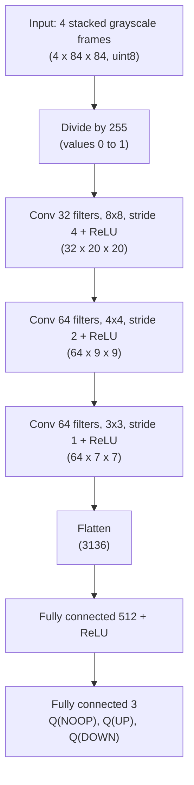
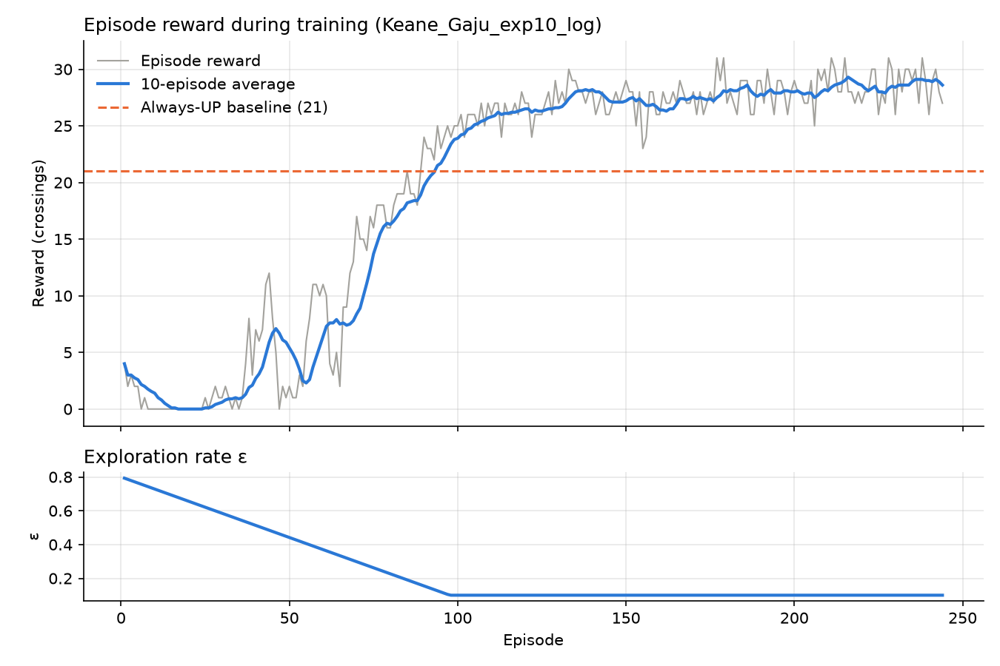
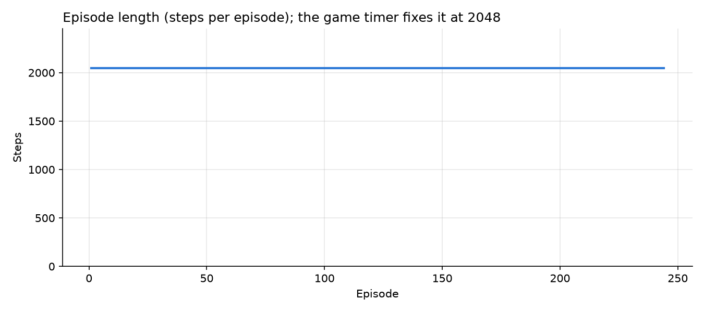
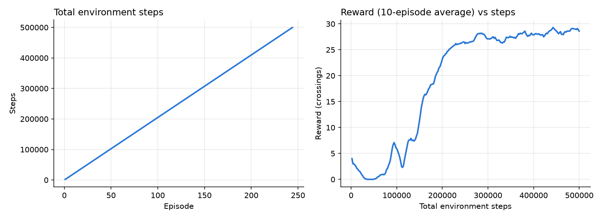
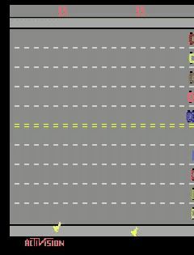

# Freeway DQN

## Project Introduction

This project trains a **Deep Q-Network (DQN)** agent, written from scratch with
PyTorch and Gymnasium, to play the Atari game **Freeway**. The agent learns only
from the game screen and the score, without being told the rules.

We did not use any library that provides a ready-made DQN (such as
Stable-Baselines3, RLlib, CleanRL or TorchRL). The Q-network, replay buffer,
ε-greedy exploration, target network and Bellman update are all in
[train.py](train.py). [play.py](play.py) loads the trained model and plays the game live.

### Group members

| Member | Role |
|---|---|
| Eddy Irasetsa | Environment and data: uv setup, environment creation, preprocessing, replay buffer, ε-greedy action selection, training loop, episode logging and model saving |
| Keane Gaju | Network and learning: CNN, online and target networks, Bellman target, loss and optimization |
| Ajak Chol | Evaluation and documentation: play.py (live gameplay and greedy evaluation), training plots, demo video, final model selection |

The full task split is in [Task_allocation_sheet.pdf](Task_allocation_sheet.pdf).

## Selected Atari Environment: Freeway

**Environment ID:** `ALE/Freeway-v5`
([documentation](https://ale.farama.org/environments/freeway/))

**Objective:** the agent controls a chicken that must cross a ten-lane highway full
of moving cars. If a car hits the chicken, the chicken is pushed back down. The
goal is to get the chicken across as many times as possible before the timer
runs out (about 2 minutes 16 seconds of game time).

| Property | Value |
|---|---|
| Observation | 210 × 160 RGB image of the screen |
| Actions | 3: `0 = NOOP` (stay), `1 = UP`, `2 = DOWN` |
| Reward | +1 each time the chicken reaches the top of the road |
| Episode length | 2048 agent steps (the game timer ends the episode) |
| Frame skip | 4: the v5 environment repeats each action for 4 frames |
| Sticky actions | 25% chance the previous action repeats (v5 default), which adds randomness |

**Why we chose Freeway:** it has only 3 actions, no lives or FIRE button to handle,
and frequent rewards, so the improvement from random play to trained play is
easy to see in the training plots.

**Baselines for comparison** (measured with our environment code):

- A **random agent** almost never crosses (0 points in our test episodes), because it presses
  UP only one third of the time and gets knocked back by cars.
- An agent that **always presses UP** scores about **21**. To beat this, the trained
  agent has to learn to wait for gaps in the traffic instead of walking into cars.

### Preprocessing

Each raw frame is processed before it reaches the network:

1. **Grayscale:** colour is not needed to see the cars and the chicken.
2. **Resize to 84 × 84:** a smaller image makes training much faster.
3. **Stack the last 4 frames:** a single frame cannot show which way or how
   fast the cars are moving, so the agent sees 4 consecutive frames. The input
   to the network has shape `(4, 84, 84)`.

Frames are stored as `uint8` (0–255) in the replay buffer to save memory.

## Setup

This project uses [uv](https://docs.astral.sh/uv/) as its only package manager.

```bash
uv sync                                   # install the exact dependencies from uv.lock
uv run python train.py --help             # see all hyperparameters
uv run python train.py --lr 1e-4 --gamma 0.99 --output-dir Eddy_Irasetsa --exp-name exp01
uv run python play.py                     # watch the trained agent play (dqn_model.pth)
uv run python play.py --no-render --episodes 10            # greedy score check without a window
uv run python play.py --video demo/gameplay_demo.mp4       # record one game
uv run python plot_training.py --log Ajak_Chol/exp08_log.csv   # training plots of the best run
```

## DQN Architecture

### Network architecture



The convolutional layers learn to see the chicken, the cars and how the cars move across
the 4 stacked frames. The fully connected layers turn that into one Q-value per action.
The agent plays the action with the highest Q-value.

### Training process

1. **Play:** the agent picks an action with epsilon-greedy. It starts almost fully random and
   explores less as epsilon decays, so it uses more of what it has learned over time.
2. **Remember:** every step `(state, action, reward, next_state, done)` goes into the
   replay buffer.
3. **Learn:** after the warm-up, every few steps we sample a random batch from the buffer.
   Random sampling breaks the link between consecutive frames and stabilises learning.
4. **Bellman target:** for each sample the target is
   `r + gamma * max Q_target(s', a')`, or just `r` if the game ended.
5. **Loss and update:** the online network predicts `Q(s, a)` for the action taken. The
   Huber loss compares it with the target. Backpropagation computes the gradients and
   Adam updates the online network.
6. **Target network:** a second copy of the network computes the targets. It is only
   refreshed from the online network every `--target-update` steps, so the targets do not
   move on every update.
7. **Save:** at the end, the online network's weights are saved to `dqn_model.pth`.

## Training Results

### Choosing the final model

Training rewards include random ε actions, so we picked the final model by playing all 30 saved
models **greedily** (ε = 0, exactly as `play.py` does), 3 games each, then 10 games (seeds 100-109)
for the best ones: `uv run python play.py --model <path> --no-render --episodes 10 --seed 100`.

| Result | Models |
|---|---|
| Only press UP, score exactly 21 (the always-UP baseline) | 21 of 30 |
| Slightly above the baseline (22-25) | Eddy exp05, Eddy exp08, Ajak exp09 |
| Learned to wait for gaps (about 30) | **Ajak exp08 (31.6)**, Ajak exp10 (30.9), Keane exp10 (30.7), Ajak exp07 (29.9) |
| Below the baseline | Ajak exp03 (18.7), Eddy exp10 (0.0) |

**Final model: Ajak Chol, experiment 8** (lr 1e-4, γ 0.99, batch 64, ε 0.1 → 0.01 over 50k steps),
saved as `dqn_model.pth`. Over 10 greedy games it averaged **31.6 crossings (range 29–33)**, about
10 more than an agent that always presses UP, because it waits for gaps in the traffic (NOOP on 22% of steps).

**What the four good models have in common:** they all started with a low ε (0.1, 0.5 or 0.8). The
untrained network (seed 42) already presses UP 99% of the time, so with little random play the agent crosses
from the first episode and spends training learning *when* to wait. Runs that started at ε 1.0 played
randomly (score 0) for 60-190 episodes and then settled on "always UP". Details are in
[Ajak_Chol_Hyperparameter_experiment_results.md](Ajak_Chol_Hyperparameter_experiment_results.md).

### Training plots (best run)



The reward starts at about 20 because the untrained network already presses UP. It drops to about 1
around episode 17, when the first updates change the weights, then recovers, passes the always-UP baseline
at episode 50 and keeps improving to about 30 (with ε at 0.01 from episode 25).



Every episode lasts exactly 2048 steps, because a Freeway game ends when the timer runs out, not
when the chicken is hit. Episode length therefore cannot show progress in this game; the reward does.



Each member's 10 experiments side by side: [Eddy](plots/Eddy_Irasetsa_experiments.png),
[Keane](plots/Keane_Gaju_experiments.png), [Ajak](plots/Ajak_Chol_experiments.png).

## Gameplay Demonstration



The first 25 seconds of a greedy game by `dqn_model.pth` (left chicken). Full game (32 crossings):
[demo/gameplay_demo.mp4](demo/gameplay_demo.mp4).
